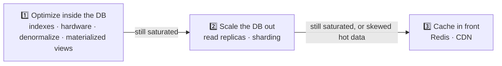
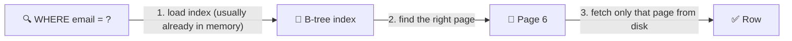
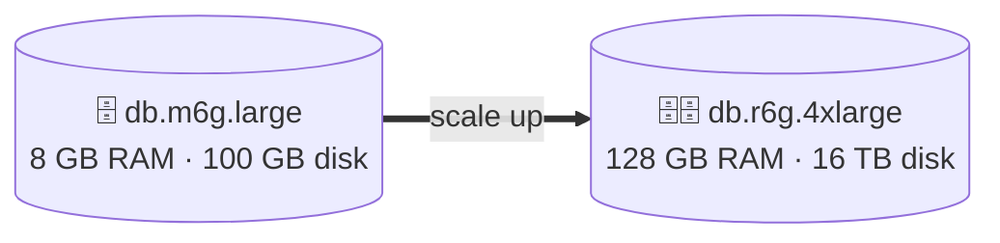
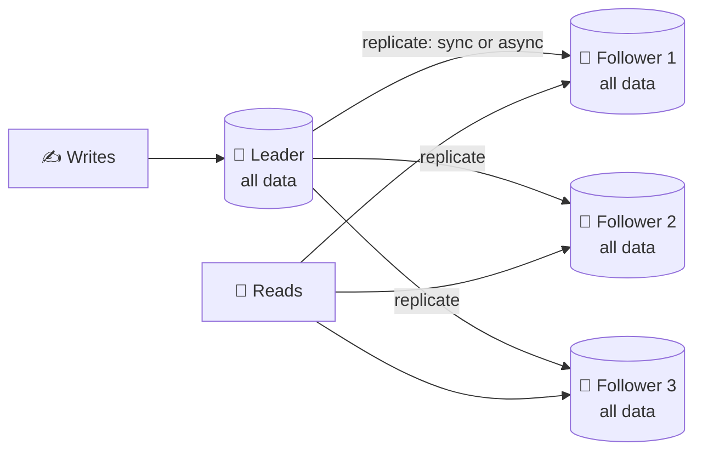
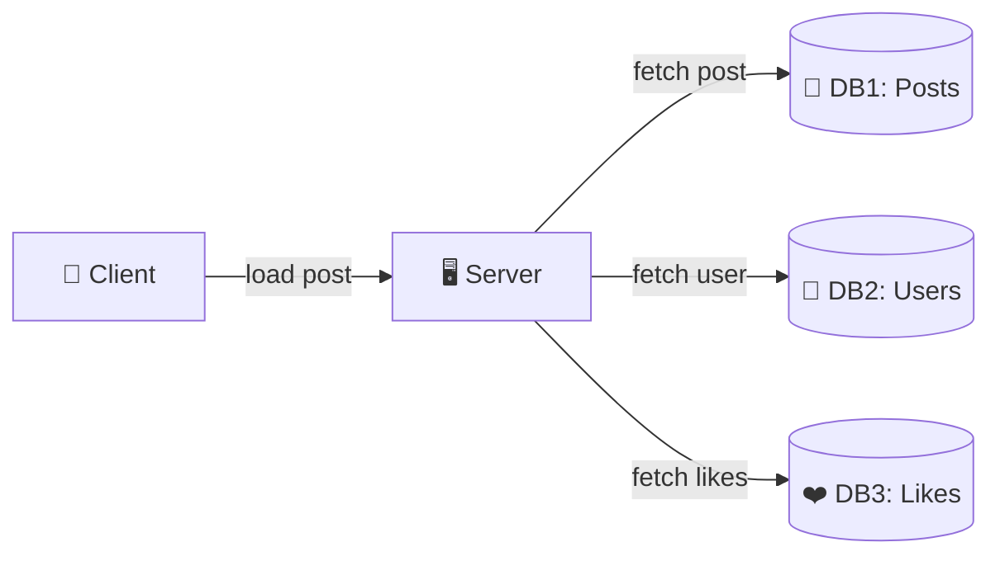
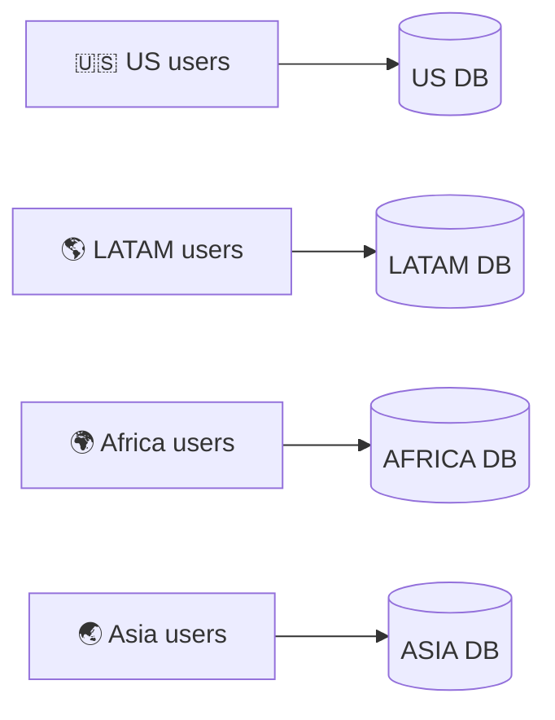
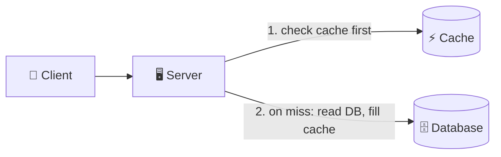
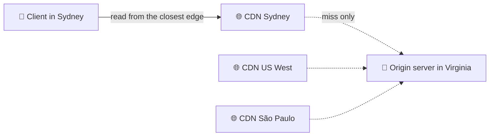
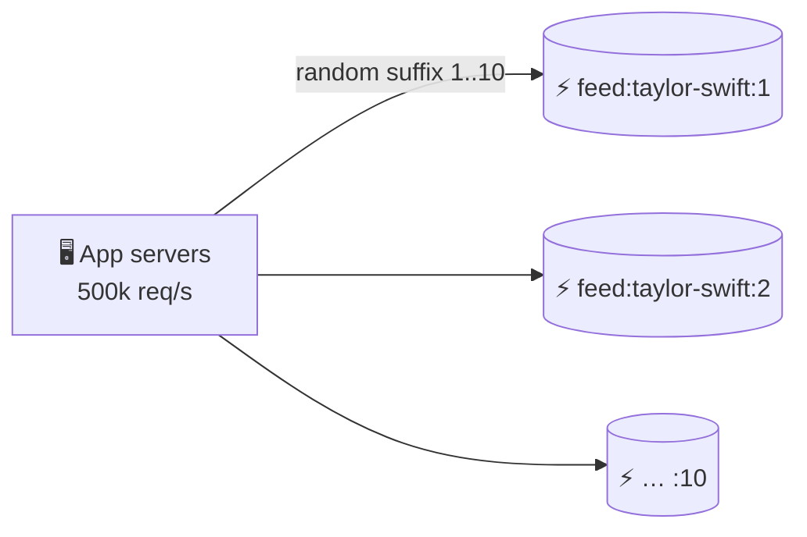
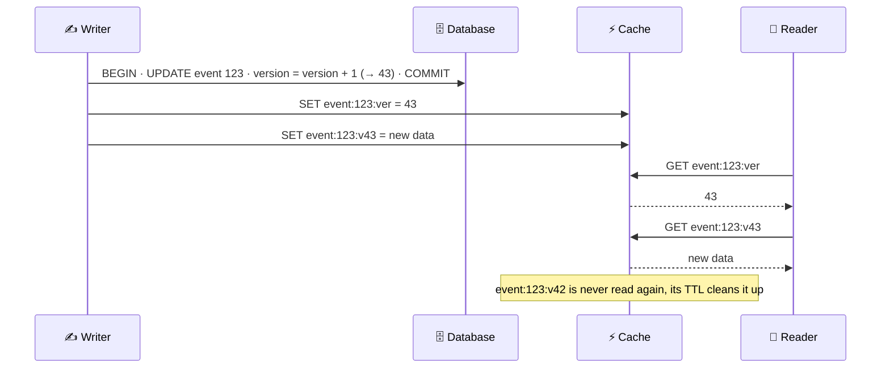

{: .intuition }
> **One-line pitch:** Reads grow far faster than writes, and eventually physics wins: one box only has so much CPU, RAM and disk I/O. Climb the ladder in order: **optimize inside the database** (indexes, denormalization, materialized views), then **scale it out** (read replicas), then **cache in front of it** (Redis, CDN). You get credit for knowing *which rung the problem actually needs*, and for handling the edge cases: hot keys, stampedes, and invalidation that must be immediate.

<details markdown="block">
<summary>Contents</summary>

- TOC
{:toc}
</details>

---

## 1. The Problem

Open Instagram and the feed fires **100+ reads**: photo metadata, author info, like counts, comment previews. You might post **one** photo a day. That imbalance is the norm:

| Product | Writes | Reads | Ratio |
|---|---|---|---|
| Typical app | Baseline | Baseline | **10:1** to start |
| Twitter | One tweet posted | Read by thousands | 1000:1+ |
| Amazon | One product listed | Browsed by hundreds | 100:1+ |
| YouTube | Millions of uploads/day | Billions of views/day | 1000:1 |
| **Bitly** | URL shortened once | Clicked millions of times | Extreme |

{: .insight }
> **This isn't a bug you can debug your way out of — it's physics.** CPU cores execute a finite number of instructions per second, RAM holds a finite working set, and disk I/O is bounded by the hardware. Once one database hits those limits, the only moves are: **do less work per read**, **spread reads across more machines**, or **stop reading from the database at all**.

---

## 2. The Ladder

Read scaling is a progression from cheap and simple to powerful and complex. Climb only as high as the numbers force you.



{: .pitfall }
> **Most candidates jump straight to distributed caching.** A well-indexed Postgres handles far more than people expect. Starting at rung 3 without touching rung 1 reads as pattern-matching. Show that you exhausted the simple fix first.

---

## 3. Rung 1 — Optimize Within the Database

There's usually plenty of headroom in the database you already have.

### 3.1 Indexing

An index is a **sorted lookup structure** pointing at the rows. Like a book's index: instead of reading every page for "database", you check the back and jump to the right pages.

- **No index → full table scan:** O(n). Read all 1M rows to find one.
- **B-tree index → seek:** O(log n). About 20 index entries for 1M rows.



| Index type | Good for |
|---|---|
| **B-tree** ✅ | **Default.** Equality, ranges, sorting |
| Hash | Exact-match lookups only |
| Full-text (inverted) | Keyword search in text |
| Geospatial (R-tree, geohash) | "Near me" queries |

**What to index:** columns you **filter on, join on, or sort by**. Users search posts by hashtag → index `hashtag`. Products sorted by price → index `price`. Composite-index rules (leftmost prefix, equality before range) are in [**Data Modeling §5**](../core-concepts/data-modeling.html#5-indexing-for-access-patterns).

{: .aside }
> **"Too many indexes slow down writes" is real but overblown.** Every index is a write tax (as [Data Modeling](../core-concepts/data-modeling.html#5-indexing-for-access-patterns) says), but modern engines handle well-chosen indexes easily. **Under-indexing kills far more applications than over-indexing.** In an interview, add indexes for your query patterns confidently; only hold back on genuinely write-heavy tables.

### 3.2 Hardware upgrades (vertical scaling)

Boring, but effective, and often the fastest way to buy breathing room.

| Upgrade | Effect |
|---|---|
| Spinning disk → SSD | 10–100× faster random I/O |
| More RAM | More of the working set stays in the buffer pool instead of on disk |
| Faster / more CPU cores | More concurrent queries |



{: .say }
> **Mention it in one sentence, then move on.** *"First I'd check we're not just under-provisioned — a bigger instance buys time."* Interviewers rarely want this as the answer because it sidesteps the question.

### 3.3 Denormalization

**Normalization** splits data across tables so each fact is stored once. Great for writes and storage; expensive for reads, because every read re-joins.

**Normalized** — showing an order summary needs a 4-way join:

| User table | | | Order table | | | Product table | |
|---|---|---|---|---|---|---|---|
| Evan | Seattle | 3-10-25 | Evan | Table | 1 | Table | $100 |
| Stefan | Seattle | 4-04-25 | Evan | Chair | 4 | Chair | $50 |
| Glenn | San Fran | 12-25-24 | Glenn | Lamp | 2 | Lamp | $70 |

```sql
SELECT u.name, o.order_date, p.product_name, p.price
FROM users u
JOIN orders o       ON u.id = o.user_id
JOIN order_items oi ON o.id = oi.order_id
JOIN products p     ON oi.product_id = p.id
WHERE o.id = 12345;
```

**Denormalized** — one wide `order_summary` row with the user and product copied in:

| order | qty | user | product |
|---|---|---|---|
| Table | 1 | `{name: Evan, location: Seattle, date: 3-20-25}` | `{product: Table, cost: $100}` |

```sql
SELECT user_name, order_date, product_name, price
FROM order_summary
WHERE order_id = 12345;
```

{: .insight }
> **Denormalization optimizes reads at the expense of writes.** A user renaming themselves now rewrites every order row, but that happens rarely compared with viewing orders. **Check the read/write ratio before you denormalize**; if writes are frequent, the complexity isn't worth it. The full trade-off (and the "normalized source of truth + denormalized cache" middle ground) is in [**Data Modeling §6**](../core-concepts/data-modeling.html#6-normalization-vs-denormalization).

### 3.4 Materialized views

Take denormalization further: **precompute expensive aggregations** once (on a schedule or via a background job) and read the stored result.

```sql
-- Instead of this on every product page load:
SELECT p.id, AVG(r.rating) AS avg_rating
FROM products p JOIN reviews r ON p.id = r.product_id
GROUP BY p.id;

-- Precompute and store it:
CREATE MATERIALIZED VIEW product_ratings AS
SELECT p.id, AVG(r.rating) AS avg_rating
FROM products p JOIN reviews r ON p.id = r.product_id
GROUP BY p.id;
```

{: .aside }
> **Staleness is the price.** A Postgres materialized view only changes on `REFRESH MATERIALIZED VIEW` (use `CONCURRENTLY` so reads aren't blocked). Say how often you refresh, and tie it to how stale the number may be: "average rating can lag by 10 minutes."

---

## 4. Rung 2 — Scale the Database Horizontally

**Rule of thumb:** a single well-indexed database needs help (replicas *or* a cache) somewhere around **50,000–100,000 reads/sec**. It's rough — it depends on data model, query shape and hardware — but in an interview a rough number is all you need to justify the move.

### 4.1 Read replicas

Copy the primary's data to extra servers. **All writes go to the primary (leader); reads can go to any follower.** Bonus: redundancy — if the leader fails, promote a follower.



| Replication | Write ack happens… | Reads | Cost |
|---|---|---|---|
| **Synchronous** | After followers confirm | Consistent on every replica | Slower writes; a slow follower stalls the leader |
| **Asynchronous** ✅ | As soon as the leader commits | Possibly stale (**replication lag**) | Fast writes; a failover can lose the last few writes |

{: .pitfall }
> **Replication lag is the classic follow-up.** The user saves, the page reloads from a lagging follower, and the save looks lost. Fixes (read-your-own-writes from the primary for a short window, tracking the write's LSN, sticky replicas) are in [**CAP Theorem §7.2**](../core-concepts/cap-theorem.html#72-read-your-own-writes-in-practice). Have one ready.

### 4.2 Sharding

Replicas spread the **load** but every replica still holds the **whole dataset**. When the dataset is so big that even indexed queries are slow, split it.

For reads, sharding helps two ways: **smaller datasets per node → faster queries**, and **load spread across nodes**.

**Functional sharding** — split by business domain:



**Geographic sharding** — users' data lives near them; good for global read latency:



{: .insight }
> **Sharding is primarily a *write*-scaling tool.** It brings big operational complexity (shard keys, cross-shard queries, resharding — see [**Sharding**](../core-concepts/sharding.html)). For most read-scaling problems, **replicas and caches are cheaper and more effective.** Reach for sharding when the dataset size, not the read rate, is the problem.

---

## 5. Rung 3 — Add External Caching Layers

Once the DB is optimized you have two levers: more replicas or a cache. For read-heavy workloads, **caches usually win**, for one reason:

{: .insight }
> **Access is highly skewed.** Millions read the same viral tweet; thousands view the same popular product. You keep asking the database for **identical data that rarely changes**. A cache serves precomputed results from RAM in **sub-millisecond** time versus **tens of milliseconds** for even a good DB query.

### 5.1 Application-level caching (Redis / Memcached)



Popular data stays warm on its own: celebrity profiles are hit constantly and never age out, while inactive profiles get cached on access and expire after the TTL.

**Invalidation strategies — the hard part:**

| Strategy | How | Trade-off |
|---|---|---|
| **TTL (time-based)** | Fixed lifetime per entry | Simple; stale until expiry. Good for predictable update patterns |
| **Write-through invalidation** | Update or delete the entry on every DB write | Consistent; adds write latency and needs careful error handling |
| **Write-behind invalidation** | Queue invalidation events, process asynchronously | Faster writes; a window where stale data is served |
| **Tagged invalidation** | Tag entries (`user:123:posts`); purge everything with a tag | Handles complex dependencies; you must maintain the tag → key map |
| **Versioned keys** | Version in the key; bump the version on write | Simple and race-free; needs version tracking (deep dive §7.4) |

{: .say }
> **Production answer: combine them.** *"Short TTLs — 5 to 15 minutes — as a safety net everywhere, plus active invalidation on critical data like profiles and inventory counts. Recommendation scores just ride the TTL."*

{: .insight }
> **Let the non-functional requirements pick the TTL.** "Search results may be at most 30 s stale" → TTL = 30 s. "Profiles can be 5 minutes stale" → TTL = 5 min. That turns the TTL from a guess into a stated consistency bound.

Patterns (cache-aside vs read-through, write-through, write-behind), eviction, and failure modes are covered in depth in [**Caching**](../core-concepts/caching.html).

### 5.2 CDN and edge caching

CDNs extend caching out to **edge locations around the world**. Originally for static assets, they now cache API responses and query results too.



- **Latency:** a Tokyo user served from a Tokyo edge sees **under 10 ms** instead of a **≈200 ms** round trip to Virginia.
- **Origin load:** cached requests never reach you. For read-heavy apps a CDN can absorb **90%+** of origin traffic.
- **Cost:** invalidation across many edge locations.

{: .pitfall }
> **CDNs only help with data that many users share.** Product catalogs, public posts, search results: yes. Personal preferences, private messages, account settings: no — only one user ever requests them, so the hit rate is zero (and caching them at a shared edge is a data-leak risk).

---

## 6. When to Use It in Interviews

Nearly every interview ends with scaling, and for read-heavy systems this is where it starts. **Walk your API, find the high-volume read endpoints, and optimize those**: query first, then caching and replicas.

{: .say }
> **Flag it proactively while sketching the API:** *"This profile endpoint is hit every time someone views a profile. With millions of users that's billions of reads a day — I'll come back to that in the deep dive."*

### 6.1 Common scenarios

| Problem | Read-scaling play |
|---|---|
| **Bitly / URL shortener** | Extreme ratio and **immutable** mappings → cache short → long in Redis with **no expiry**, CDN for global traffic. The DB only sees misses on unpopular links |
| **Ticketmaster** | Event page hammered at on-sale → cache event details, venue info, seat maps aggressively. **Never cache seat availability for purchase** (oversell). Replicas for browsing; primary for buying |
| **News feed** (Facebook, LinkedIn, Twitter) | Precompute feeds for active users, cache recent posts from followed accounts, paginate. Users read the top few items, so caching recent content pays off hugely |
| **YouTube / video platforms** | Video metadata (title, description, thumbnail) rarely changes → cache aggressively. View counts eventually consistent, updated every few minutes. CDN for thumbnails |

### 6.2 When NOT to use it

| Situation | Why read scaling is the wrong focus |
|---|---|
| **Write-heavy systems** (Uber driver locations every few seconds) | Ratio is ≈1:1 or 2:1; scale writes first |
| **Small scale** ("design for 1,000 users") | One indexed database handles thousands of QPS. Solve the stated problem, not an imagined one |
| **Strong consistency** (payments, inventory) | Stale reads cause real damage. If you cache at all: aggressive invalidation, short TTLs, never on the transactional path |
| **Real-time collaboration** (Google Docs) | Every keystroke must be visible immediately; caching actively hurts |

{: .aside }
> **Read scaling is about reducing database load, not just latency.** If the DB copes fine but responses are slow for distant users, that's a different problem (edge compute, regional deployments).

---

## 7. Common Deep Dives

### 7.1 "Queries get slower as the dataset grows"

Launched with 10k users, snappy. Now 10M users, a login takes 30 s and DB CPU is pinned at 100% on trivial queries.

**Cause:** no index → every login scans all 10M rows. At 200 bytes/row that's **2 GB scanned to find one user**, times hundreds of concurrent logins. Joins without indexes multiply it: scan users × scan orders = billions of comparisons.

**Fix:** index what you filter on.

```sql
-- Before: full table scan
EXPLAIN SELECT * FROM users WHERE email = 'user@example.com';
-- Seq Scan on users  (cost=0.00..412000.00 rows=1)

CREATE INDEX idx_users_email ON users(email);

-- After: index scan
EXPLAIN SELECT * FROM users WHERE email = 'user@example.com';
-- Index Scan using idx_users_email  (cost=0.43..8.45 rows=1)
```

**Composite order matters.** An index on `(status, created_at)` serves `WHERE status = ?` and `WHERE status = ? AND created_at > ?`, but **not** `WHERE created_at > ?` alone.

<div class="viz">
<p class="viz-legend"><span class="done">■ contiguous range = seek</span> · <span class="hl">■ scattered = scan</span></p>




</div>

{: .say }
> **Name your indexes while you draw the schema.** It costs one sentence and shows you're already thinking about the read path.

### 7.2 "Millions of concurrent reads for the same cached key"

A celebrity posts. Your cache tier normally handles 50k req/s; now **500k req/s hit one key**. The data is in memory, but serializing and sending it 500k times a second saturates that one node's CPU and network. Caching assumed load spreads across keys — a hot key breaks that.

**Fix 1 — Request coalescing.** Concurrent requests for the same key share one in-flight fetch:

```python
class CoalescingCache:
    def __init__(self):
        self.inflight = {}  # key -> Future

    async def get(self, key):
        if key in self.inflight:          # someone is already fetching it
            return await self.inflight[key]

        future = asyncio.get_running_loop().create_future()
        self.inflight[key] = future
        try:
            value = await fetch_from_backend(key)
            future.set_result(value)
            return value
        except Exception as e:
            future.set_exception(e)       # waiters must fail too, not hang
            raise
        finally:
            del self.inflight[key]
```

{: .insight }
> **Coalescing caps backend load at N requests per key, where N = number of app servers** (each coalesces locally). Millions of users → N fetches. It protects whatever sits *behind* the coalescer.

**Fix 2 — Cache key fanout.** When even N is too much for the one cache node, store **identical copies** under several keys that hash to different nodes; clients pick one at random.



500k req/s across 10 copies = **50k each**, a load one node handles. **Cost:** 10× memory for that key, and invalidation must clear all 10 copies. More hot-key fixes (in-process L1, replicas) are in [**Caching §6.3**](../core-concepts/caching.html#63-hot-keys).

### 7.3 "An expired entry gets rebuilt by everyone at once" (cache stampede)

Homepage at 100k req/s, all from cache, 1-hour TTL. At minute 60 the entry vanishes and **all 100k requests miss in the same instant**. A database sized for ≈1k misses/sec gets 100k identical — and possibly expensive — queries: a DDoS from your own app.

| Approach | How | Downside |
|---|---|---|
| **Distributed lock** | First request to miss takes a lock and rebuilds; others wait | If the rebuild fails or is slow, thousands time out waiting. Fragile under load |
| **Probabilistic early refresh** ✅ | As the entry ages, each request has a small, rising chance of refreshing it in the background while still serving the cached value | A few requests do extra work; no coordination needed |
| **Background refresh** | A job refreshes critical entries before expiry (homepage every 50 min on a 60-min TTL) | Wasted work on data nobody asks for; more infra. Worth it for the most critical keys |

Probabilistic early refresh for a 60-minute TTL — refresh chance per request:

<div class="viz">
<p class="viz-legend"><span class="hl">■ refresh window</span></p>
{% include array.html v="0%,0%,1%,5%,20%" hl="2,3,4" label="minute" note="0 · 30 · 50 · 55 · 59 — refreshes spread over the last 10–15 min, not all at minute 60" %}
</div>

{: .aside }
> **The formula, if pushed (XFetch, Vattani et al. 2015):** refresh early when `now − δ·β·ln(rand()) ≥ expiry`, where δ is how long a rebuild takes and β ≈ 1. Slow rebuilds start refreshing earlier. Cache-side detail (single-flight with `SET NX PX`, stale-while-revalidate, TTL jitter) is in [**Caching §6.1**](../core-concepts/caching.html#61-cache-stampede-thundering-herd).

### 7.4 "Updates must be visible immediately"

An organizer changes the venue address. Attendees can't see the old one for an hour. But the value may sit in **Redis, CDN edges and browser caches** at once.

**Naive fix: delete the cache entry after the write.** It breaks three ways:

1. **Which caches?** Application, CDN, browser — you can't reach all of them.
2. **What if the delete fails?** The stale value lives until TTL.
3. **Race:** a reader that read the DB just *before* your commit writes the old value back *after* your delete (the stale-set race, [**Caching §6.2**](../core-concepts/caching.html#62-cache-consistency)).

**Better: versioned cache keys.** Don't delete old entries — make them unreachable.

- Each row carries a `version` column, incremented **in the same transaction** as the update.
- Cache keys include it: `event:123:v42` → `event:123:v43`.



**Read:** get the version (small cached key, DB fallback) → build `event:123:v{n}` → read; on miss, load from DB and fill **that versioned key**.

| ✅ Why it works | ❌ What it costs |
|---|---|
| **No stale-set race:** a late writer can only fill an old version's key, which nobody reads | **Two cache lookups** per read (version, then data) |
| **No partial invalidation:** you route around old entries instead of deleting them | **Old versions pile up:** give them a TTL |
| **Concurrency-safe:** the DB increments the version atomically, so keys never collide | Fits **single entities** (profiles, events), not feeds or search results |
| **CDN and browsers too:** put the version in the URL and stale edge copies just age out | |

{: .pitfall }
> **The version pointer is itself a cache entry.** Two writers can SET `event:123:ver` out of order (43 after 44). Only ever move it forward (a Lua "set if greater"), or skip caching it and read the version from the DB, which is a cheap primary-key lookup.

**When versioning doesn't fit** (feeds, search results, aggregates):

- **Deleted-items cache:** keep a small set of recently deleted / hidden / changed IDs. When serving a cached feed, **filter it against that set first**, then fix the big cached structures in the background. Serves mostly-correct data immediately; ideal for moderation and privacy takedowns.
- **CDN:** purge APIs exist but propagate slowly across hundreds of edges. For critical data, send `Cache-Control` headers that skip the edge entirely; for less critical data, use a **short edge TTL with a longer app-cache TTL**.

{: .insight }
> **Different data, different staleness budget.** Profiles: 5 minutes is fine. Venue address: must be immediate. Design the strategy per data type instead of applying one rule everywhere.

---

## 8. Problems That Use This Pattern

**Ticketmaster** · **Bitly** · **Instagram** · **FB News Feed** · **YouTube Top K** · **Yelp** · **Distributed Cache** · **Rate Limiter** · **YouTube** · **FB Post Search** · **Local Delivery Service** · **News Aggregator** · **Metrics Monitoring**

---

## 9. Level Expectations

| Level | What you must demonstrate |
|---|---|
| **Mid** | Adds indexes for obvious queries. Adds a Redis cache and read replicas on the read-heavy path. Knows replicas can be stale |
| **Senior (E5)** | **Climbs the ladder in order** and justifies each rung with a number (QPS, the 50–100k reads/sec threshold). Picks a TTL from the staleness requirement. Handles replication lag with read-your-own-writes. Says what it won't cache (seat availability). Solves one deep dive concretely: coalescing, early refresh, or versioned keys |
| **Staff+** | Treats staleness as a per-data-type budget across layers (browser, CDN, Redis, replica). Separates hot key (cache node flooded) from stampede (DB flooded) and gives the right fix for each. Knows the limits of each fix: coalescing caps load at N servers, fanout multiplies invalidation, versioning doesn't fit feeds. Knows when *not* to scale reads (write-heavy, small scale, collaboration) |

---

## 10. Personal Drill List

*Targets recurring gaps from previous mock sessions.*

**1. Rung 1 before rung 3.** Say the index first, out loud, before Redis appears. *"`email` is indexed, so the login lookup is a seek; caching only matters for the profile endpoint at 50k QPS."*

**2. Earn every rung with a number.** "Reads are ≈100:1, peak is ≈80k reads/sec on the event table, which is past one primary, so…"

**3. Check the ratio before scaling reads.** Same gap as the rate limiter and caching drills: ask *"is this path actually read-heavy?"* Location updates and counters are write problems.

**4. TTL comes from the requirements.** Don't pick "5 minutes" out of the air. Quote the staleness the NFRs allow.

**5. Have one replication-lag answer ready.** Read-your-own-writes from the primary for a few seconds after a write. One sentence.

**6. Hot key ≠ stampede.** Hot key: present, node flooded → coalesce + fanout. Stampede: missing, DB flooded → early refresh / lock / background refresh. Never blur them.

**7. Say what stays uncached.** Seat availability at checkout, balances. One sentence, big signal.

---

## 11. Rapid-Fire Self-Test

<details markdown="block">
<summary>1. What's the order of the read-scaling ladder, and why that order?</summary>

Optimize inside the DB (indexes, hardware, denormalization, materialized views) → scale it out (read replicas, then sharding) → cache in front (Redis, CDN). Cheapest and simplest first; each rung adds operational complexity.
</details>

<details markdown="block">
<summary>2. What does an index change, in big-O terms?</summary>

A full table scan, O(n), becomes a B-tree seek, O(log n): about 20 entries checked instead of 1M rows read.
</details>

<details markdown="block">
<summary>3. Index on (status, created_at). Which queries does it help?</summary>

`status = ?` and `status = ? AND created_at …`. Not `created_at …` on its own, because those rows are scattered across statuses (leftmost-prefix rule).
</details>

<details markdown="block">
<summary>4. What does denormalization trade, and when is it worth it?</summary>

Faster single-table reads for more complex, multi-location writes plus storage. Worth it when reads vastly outnumber writes to the duplicated data.
</details>

<details markdown="block">
<summary>5. What's a materialized view, and what's its cost?</summary>

A stored, precomputed query result (e.g. average rating per product). Reads are cheap; data is stale until the next refresh.
</details>

<details markdown="block">
<summary>6. Rough read throughput at which one database needs replicas or a cache?</summary>

About 50,000–100,000 reads/sec for a well-indexed database. It's rough, but enough to justify the move.
</details>

<details markdown="block">
<summary>7. Sync vs async replication?</summary>

Sync: the leader waits for followers, so reads are consistent but writes are slower. Async: the leader acks immediately, writes are fast, but followers lag and can serve stale reads.
</details>

<details markdown="block">
<summary>8. Why is sharding usually not the answer to a read problem?</summary>

It's primarily a write/dataset-size tool with heavy operational cost. Replicas and caches spread read load more cheaply. Shard when the dataset itself is too big for indexed queries to stay fast.
</details>

<details markdown="block">
<summary>9. Why do caches beat replicas for read-heavy workloads?</summary>

Access is skewed: the same popular data is read over and over. A cache serves it from RAM in under a millisecond instead of running the query again on a replica.
</details>

<details markdown="block">
<summary>10. Five cache invalidation strategies?</summary>

TTL, write-through invalidation, write-behind (queued) invalidation, tagged invalidation, versioned keys. Production systems combine a TTL safety net with active invalidation on critical data.
</details>

<details markdown="block">
<summary>11. How should you choose a TTL?</summary>

From the staleness requirement. "At most 30 s stale" → 30 s TTL.
</details>

<details markdown="block">
<summary>12. What should never be cached at a CDN?</summary>

Per-user data: private messages, preferences, account settings. Zero shared hits, and a leak risk.
</details>

<details markdown="block">
<summary>13. Request coalescing caps backend load at what?</summary>

N requests per key, where N is the number of app servers each coalescing locally, regardless of how many users ask.
</details>

<details markdown="block">
<summary>14. Cache key fanout: how and what does it cost?</summary>

Store copies under `key:1 … key:N` on different nodes; readers pick one at random, which divides the load by N. It costs N× memory and N invalidations per update.
</details>

<details markdown="block">
<summary>15. Why is probabilistic early refresh better than a lock for stampedes?</summary>

Refreshes are spread over the last stretch of the TTL while everyone keeps getting cached data. A lock makes thousands wait on one rebuild and fails badly if it's slow or crashes.
</details>

<details markdown="block">
<summary>16. Three problems with "just delete the cache key after the write"?</summary>

You can't reach every layer (CDN, browser); the delete can fail; and a concurrent reader can re-cache the old value after your delete (stale-set race).
</details>

<details markdown="block">
<summary>17. How do versioned keys avoid the race, and what do they cost?</summary>

The version is bumped in the DB transaction, so a late writer can only fill an old key nobody reads. Costs: two lookups per read, accumulating old versions (TTL them), and it only suits single entities.
</details>

<details markdown="block">
<summary>18. A post is deleted but sits inside thousands of cached feeds. Fastest correct fix?</summary>

A deleted-items cache: filter every served feed against a small set of recently deleted IDs, then rebuild the big cached feeds in the background.
</details>

<details markdown="block">
<summary>19. Name two systems where read scaling is the wrong focus.</summary>

Any two of: write-heavy (Uber driver locations), small scale (1,000 users), strongly consistent (payments, inventory), real-time collaboration (Google Docs).
</details>

---

*Related patterns to cross-review: Scaling Writes (when the primary saturates) · Dealing with Contention (seat booking stays on the primary) · Real-time Updates (pushing invalidations). Related notes: [**Caching**](../core-concepts/caching.html) (patterns, eviction, failure modes) · [**Data Modeling**](../core-concepts/data-modeling.html) (indexes, denormalization) · [**CAP Theorem**](../core-concepts/cap-theorem.html) (replication lag, read-your-own-writes) · [**Sharding**](../core-concepts/sharding.html) · **Bitly** · **Ticketmaster***
