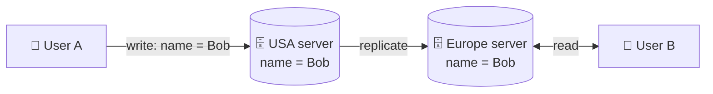
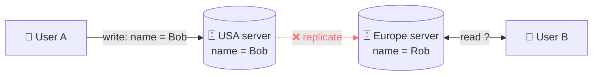
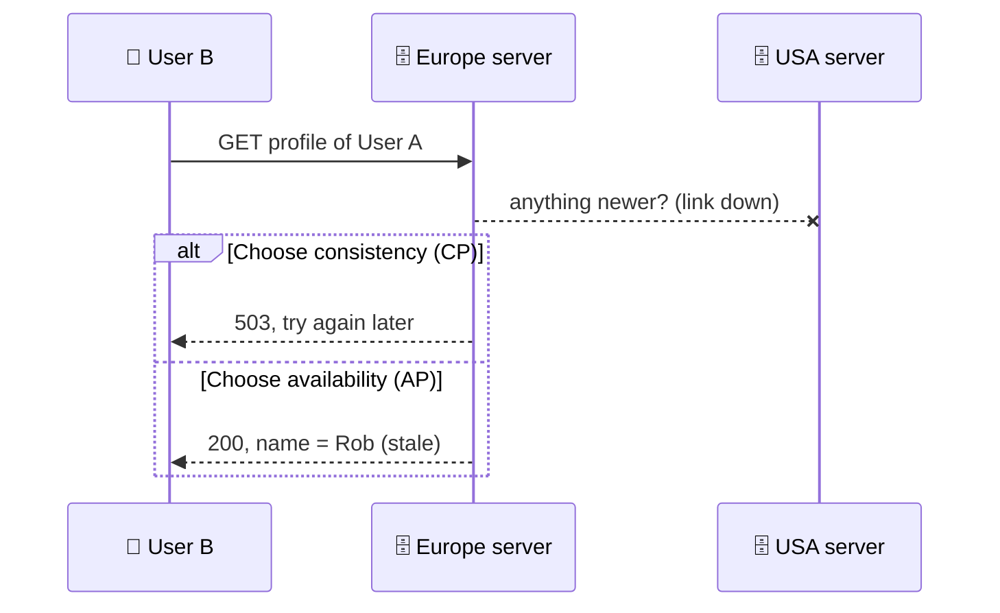
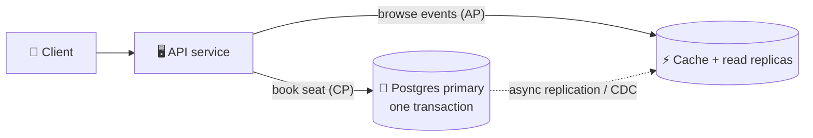
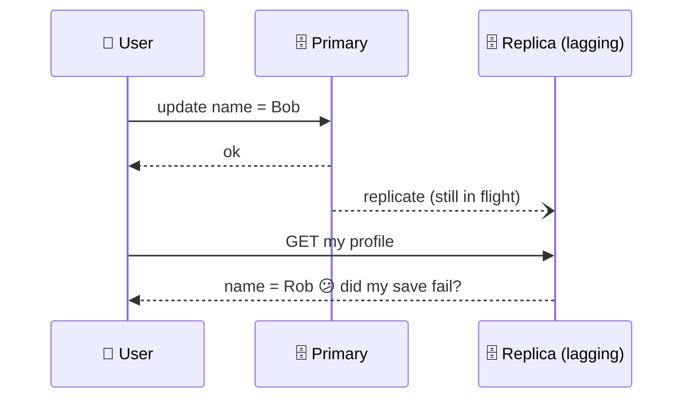

{: .intuition }
> **One-line pitch:** Once your data lives on more than one machine, the network between those machines will fail at some point. When it does, a node that can't reach the others has two options: **refuse to answer (consistency)** or **answer with what it has, even if it's stale (availability)**. Partition tolerance isn't optional, so CAP comes down to **C or A during a partition**. Most features pick **A**. Money, inventory and anything that can only be sold once pick **C**. State the choice **per feature** in your non-functional requirements, because it shapes the rest of the design.

Contents

- TOC
{:toc}

---

## 1. The Three Letters

| Letter | Formal meaning | In plain words |
|---|---|---|
| **C**onsistency | Every read returns the most recent successful write, whichever node answers it | The system behaves as if there were only **one copy** of the data |
| **A**vailability | Every request to a node that's up gets a real response, not an error or a timeout | No node says "try later" just because it can't reach the others |
| **P**artition tolerance | The system keeps running when messages between nodes are lost or delayed | The link between replicas can break and you still have a working system |

The textbook version is "pick any two of the three". For a distributed system that's misleading, and §2 explains why.

{: .pitfall }
> **CAP's C is not ACID's C.** In ACID, consistency means a transaction leaves the database valid: constraints, foreign keys and invariants all still hold. In CAP, consistency means the replicas agree, so a read anywhere returns the latest write (formally, *linearizability*). A single Postgres box has ACID consistency and no CAP question at all, because there's only one copy of the data.

---

## 2. Why It's Really C vs A

**Partitions aren't something you get to opt out of.** Cables get cut, switches die, a cross-region link flaps, and a long GC pause makes a healthy node look dead. From the inside, a node can't tell "the other side is slow" from "the other side is gone". It only sees a timeout.

So "CA" isn't a real option once data is on more than one machine. A "CA system" is one that assumes the network never fails, which in practice means a single node.

| Combo | What happens during a partition | Examples |
|---|---|---|
| **CP** | Nodes that can't confirm they're current return errors or time out until the link heals | ZooKeeper, etcd, Spanner, HBase, DynamoDB strongly consistent reads |
| **AP** | Every node keeps answering. Answers may disagree, and the system reconciles afterwards | Cassandra, DynamoDB default reads, CouchDB, DNS |
| **CA** ❌ | Not available to a distributed system. It means "no partitions", which means one node | Single-node Postgres (no replicas, so nothing to disagree) |

{: .insight }
> **CAP is one question:** *"When a replica can't reach the others, does it still answer?"* Yes means AP. No means CP. When the network is healthy you get both C and A. CAP only applies **while the failure is happening**.

---

## 3. Walkthrough: One Profile, Two Regions

### 3.1 Normal operation

You run two servers, one in the USA and one in Europe, and each user talks to the closer one.

1. **User A** (in the US) changes their display name from "Rob" to "Bob". The USA server takes the write.
2. The USA server **replicates** the change to the Europe server.
3. **User B** (in Europe) opens User A's profile. The Europe server answers, and B sees "Bob".

Replication is usually **asynchronous**: the USA server confirms the write to User A first and ships it to Europe afterwards. Even on a healthy day there's a short window (the *replication lag*) when Europe still says "Rob". Keep that in mind for §7.4.

### 3.2 The link goes down

Now the connection between the two regions drops. User A's rename still lands in the USA, but it can't reach Europe.

User B asks the Europe server for User A's profile. The Europe server **can't check whether its copy is current.** It has to pick one:

For a display name the answer is easy: **show the old name.** A slightly out-of-date name is a much better experience than an error page. That's an AP choice.

{: .pitfall }
> **Writes have the same choice.** If someone in Europe edits the same profile during the partition and the Europe server accepts it (AP), the two regions now hold **conflicting versions**. They have to be merged when the link comes back (§7.3). A CP system avoids that by refusing writes on the side that can't reach the others.

---

## 4. Choosing: C or A?

**The test:** *"If two users briefly saw different answers, could that cause a mistake you can't take back?"* If yes, pick consistency. If the worst case is that something looks a little out of date, pick availability.

### 4.1 Pick consistency when a stale read causes an irreversible mistake

| System | What a stale read causes |
|---|---|
| **Seat / ticket booking** | Seat 6A shows as free to two people during a partition, and both of them book it |
| **Inventory at checkout** | One toothbrush left, shown as in stock to several buyers, so the store oversells |
| **Payments, balances, trading** | Money spent twice, or a trade placed against an order book that's already moved |
| **Unique claims** (usernames, short-URL aliases, locks, leader election) | Two owners for something that must have exactly one |

### 4.2 Pick availability when stale only means a bit out of date

| System | What a stale read costs |
|---|---|
| **Social profiles and posts** | Someone sees an old profile picture for a few seconds |
| **Content catalogs** (Netflix titles, descriptions) | An old description shows for a while |
| **Reviews and listings** (Yelp hours) | Opening hours are briefly out of date, which still beats a blank page |
| **Feeds, counters, analytics, DNS** | A like count is off by a few, or a record takes minutes to propagate |

When you choose availability you're accepting **eventual consistency**: replicas converge, typically within milliseconds to seconds, but nothing guarantees exactly when.

{: .insight }
> **Most systems are AP for most features.** Start from availability with eventual consistency, then find the one or two operations that can't tolerate it. A senior answer isn't "the system is CP". It's "booking is CP, everything else is AP".

---

## 5. What Each Choice Does to Your Design

### 5.1 Consistency first

- **One source of truth for the critical data.** A single primary database (Postgres, MySQL) takes every write and every read that has to be fresh. This is the simplest option and usually the right one. It's capped by one machine, so if you outgrow it, [shard](sharding.html) by key and keep each transaction inside one shard.
- **Synchronous replication or quorum writes.** A write isn't acknowledged until the replicas, or a majority of them, have it. Every write waits on the network, and across regions that's a full round trip (roughly 80 ms or more between the US and Europe).
- **Consensus** (Raft, Paxos). A majority has to agree on every write, so the minority side of a partition stops accepting writes. ZooKeeper, etcd, Spanner and CockroachDB all work this way.
- **Distributed transactions (2PC)** when one operation spans several stores. They're correct but slow and fragile, so design to avoid them ([Sharding §5.3](sharding.html#53-consistency-across-shards)).
- **Read from the leader**, never from an asynchronous replica, for anything that must be current.

**What users notice:** higher latency, and errors or timeouts during failures. Plan for that: clients retry with idempotency keys, and the UI says "couldn't book, try again" instead of hanging.

### 5.2 Availability first

- **Asynchronous read replicas.** The primary acknowledges right away and ships changes in the background. Reads can go to any replica, which scales reads and survives failures, but replicas can lag.
- **Change data capture (CDC).** Tail the primary's log (the WAL or binlog, e.g. with Debezium into Kafka) and push changes out to caches, search indexes and other services. The primary never waits on any of them, and downstream copies catch up eventually.
- **Multi-leader or leaderless replication.** Any replica accepts writes (Cassandra, DynamoDB global tables). This is the most available setup, but concurrent writes to the same key conflict and need a merge rule (§7.3).
- **Caching.** A cache with a TTL is itself an availability choice. It serves possibly-stale data so it can be fast ([Caching §6.2](caching.html#62-cache-consistency)).

### 5.3 Side by side

| | Consistency first | Availability first |
|---|---|---|
| Write is acknowledged | After the replicas (or a majority) confirm | After one node has it |
| Reads go to | The leader, or a quorum | Any replica |
| Latency | Higher, since it waits on the network | Lower, since it's local |
| During a partition | The cut-off side returns errors | Every node answers, and answers can differ |
| After the partition | Nothing to merge | Conflicting writes have to be reconciled |
| Typical tech | Postgres primary, Spanner, CockroachDB, etcd / ZooKeeper | Cassandra, DynamoDB defaults, Redis replicas, CouchDB |

{: .aside }
> **Most databases let you choose per request, so name the setting, not just the product.** DynamoDB reads are eventually consistent by default, and `ConsistentRead=true` makes a read strongly consistent (it can then fail during an outage, which is exactly CP behavior). Cassandra takes a consistency level on every query (`ONE`, `QUORUM`, `ALL`). With Postgres you choose between reading the primary and reading a replica. Redis replicates asynchronously, so a failover can lose writes that were already acknowledged. "Is X CP or AP?" usually depends on how you configure and call it.

---

## 6. Mixed Requirements: Choose Per Feature

Real products need both, just for different operations.

| System | Needs consistency | Can favor availability |
|---|---|---|
| **Ticketmaster**-style booking | Reserving and paying for a seat. It can only be sold once | Event pages, search, venue details |
| **Tinder**-style dating | Creating a match. If both people swipe right at the same moment, exactly one match must exist and both must see it | Profiles, photos, the recommendation stack |
| **E-commerce** | Decrementing inventory at checkout, and taking payment | Product pages, reviews, recommendations |

The two paths can live side by side in the same service:

{: .say }
> *"For this ticketing system I'll make booking strongly consistent. A seat can only be sold once, so that write goes to a single primary inside a transaction. Browsing events is read-heavy and can be a few seconds stale, so it's eventually consistent and served from replicas and a cache."*

---

## 7. Beyond the Binary

*This section is mostly Senior and Staff territory. For mid-level interviews, §1–6 are enough.*

### 7.1 The consistency spectrum

"Consistency" in CAP means the strongest level. There's a lot of useful ground between that and "eventually".

| Model | Guarantee | Typical use |
|---|---|---|
| **Strong** (linearizable) | Every read returns the latest write. It looks like one copy | Balances, seat inventory, locks |
| **Causal** | Effects never show up before their causes. If B depends on A, everyone sees A first | A reply never appears before the message it answers. Comments appear after their post |
| **Read-your-own-writes** | You always see your own updates. Other people may lag | You edit your profile, refresh, and see the change |
| **Monotonic reads** | Once you've seen a value, you never see an older one | Refreshing a feed never makes a post disappear |
| **Eventual** | If writes stop, all replicas converge. No promise about when | DNS, like counts, view counts |

{: .insight }
> **Eventual consistency is what "choose availability" gives you by default.** The cheap upgrades on top of it, read-your-own-writes and monotonic reads, fix the bugs users actually notice without paying for strong consistency.

### 7.2 Read-your-own-writes in practice

This is the most common consistency bug in a replicated system. The user saves, the page reloads from a lagging replica, and it looks like the save failed:

| Fix | How | Trade-off |
|---|---|---|
| **Read your own data from the primary** ✅ | Always, or for a short window (longer than typical lag) after the user writes | More load on the primary |
| **Track the write position** | Remember the write's log position (LSN) or timestamp in the session, and only read from a replica that has caught up to it | More bookkeeping per request |
| **Sticky replica** | Pin each user to one replica. That also gives monotonic reads | Uneven load, and the user moves when that replica dies |
| **Optimistic UI** | The client shows the value it just sent instead of re-reading it | Only fixes the user's own screen |

### 7.3 After the partition: reconciling AP writes

If both sides accepted writes to the same key, there are now two versions and something has to decide what happens.

| Strategy | How | Trade-off |
|---|---|---|
| **Last write wins (LWW)** | Keep the version with the latest timestamp. Cassandra's default | Simple, but **silently drops** the other write, and clock skew can pick the wrong winner |
| **Version vectors + app merge** | Detect that two versions are concurrent and hand both to the application to merge | Nothing is lost, but the app has to merge. Amazon's Dynamo merged shopping carts by union, so deleted items could reappear |
| **CRDTs** | Data types that merge automatically (counters, sets, registers) | Only works for structures that have a CRDT |
| **Single home per key** | Route all writes for a key to one region | Nothing to merge, but writes fail when that region is unreachable, so writes are effectively CP |

### 7.4 PACELC: the trade-off you pay every day

CAP only describes behavior during a partition, and partitions are rare. **PACELC** (Daniel Abadi) adds the everyday case: if there's a **P**artition, choose **A** or **C**. **E**lse, choose **L**atency or **C**onsistency.

Strong consistency costs latency even on a perfect day, because every write has to wait for replicas to confirm. With replicas in the US and Europe, that's a transatlantic round trip on every write.

| System | During a partition | Normal operation |
|---|---|---|
| Cassandra, DynamoDB (defaults) | **A**vailability | **L**atency: ack locally, replicate later |
| Spanner, etcd, HBase | **C**onsistency | **C**onsistency: wait for the majority or the leader |

{: .aside }
> **Did Spanner beat CAP?** No. Google describes Spanner as "effectively CA" because its private network makes partitions extremely rare. When one does happen, Spanner chooses consistency, so technically it's CP (Brewer, 2017). The lesson is that **availability in CAP is about behavior during a partition, not your uptime number.** A CP system can still offer five nines.

### 7.5 Quorums: tuning C vs A per query

Leaderless stores (Cassandra, and the original Dynamo design) keep **N** copies of each key. A write waits for **W** acknowledgements, and a read asks **R** replicas and keeps the newest answer. If **R + W > N**, every read set overlaps every write set, so at least one replica a read touches has the latest acknowledged write.

■ acknowledged the latest write · ■ asked by the read · N = 3 replicas, numbered under each cell





| Setting (N = 3) | Overlap? | Tolerates one replica down for… | Character |
|---|---|---|---|
| **W=2, R=2** (`QUORUM` both ways) ✅ | Yes | Reads **and** writes | The usual "consistent enough" setting |
| W=1, R=1 (`ONE`) | No | Reads and writes | Fastest and most available, eventually consistent |
| W=3, R=1 | Yes | Reads only. One dead replica blocks **every write** | Fast reads, fragile writes |

{: .pitfall }
> **R + W > N is not full linearizability.** Sloppy quorums, last-write-wins with clock skew, and writes that fail partway leave edge cases (Kleppmann, *Designing Data-Intensive Applications*, ch. 5). Call it "quorum consistency", not "strong consistency", and use a real single-leader or consensus store when it truly can't be wrong.

---

## 8. CAP in the Interview

### 8.1 Where it goes

**In the non-functional requirements, right after the functional ones.** It's one of the first decisions you make, because the answer changes:

- which database you pick, and how you configure it
- synchronous vs asynchronous replication
- whether a feature can be cached, or read from a replica
- what the user sees when something fails

### 8.2 The three beats

1. **Name the operation that needs strong consistency, and what breaks without it.** "A seat could be sold twice."
2. **Default everything else to availability, with a staleness budget.** "Profiles can be a few seconds stale."
3. **Tie each choice to a mechanism.** A primary plus a transaction for the first, replicas, a cache or CDC for the rest.

{: .say }
> **~30-second narration, dating app:**
>
> *"Profiles and the recommendation stack can favor availability. If someone's new photo takes a few seconds to show up, nobody notices, so those reads come from replicas and a cache. Matching is different. If two people swipe right on each other at the same moment, exactly one match has to be created and both of them have to see it. So the swipe write and the match check happen atomically in one place, a single record keyed by the user pair, with strong consistency."*

### 8.3 Red flags

| Don't say | Why | Say instead |
|---|---|---|
| "I'll go with CA" | Distributed systems don't get to skip partitions | "Partitions will happen, so the choice is C or A, and here it's…" |
| "The whole system is strongly consistent" | Expensive, slower, and unnecessary for most features | Name the one or two operations that need it |
| "Cassandra is AP, so I can't use it here" | Consistency levels are per query | "Cassandra at `QUORUM` for this, `ONE` for that" |
| "We'll use eventual consistency" with nothing else | Says nothing about what users see | Give a staleness budget, and handle read-your-own-writes |

---

## 9. Level Expectations

| Level | What you must demonstrate |
|---|---|
| **Mid** | Defines C, A and P. Knows partitions are a given, so the real choice is C vs A. Picks the right side for the problem and gives a reason |
| **Senior (E5)** | **Unprompted**: chooses per feature, not per system. Ties each choice to a mechanism (primary + transaction vs replicas, cache, CDC). Keeps ACID consistency and CAP consistency separate. Names database settings (`ConsistentRead`, Cassandra consistency levels). Handles read-your-own-writes |
| **Staff+** | Brings in PACELC: the latency cost of consistency when nothing is broken, with cross-region numbers. Knows quorum math and where it stops being linearizable. Has a plan for reconciling writes after a partition (LWW, version vectors, CRDTs, single home region). Knows CP doesn't mean low uptime (Spanner). Designs what the user sees when a CP path refuses |

---

## 10. Personal Drill List

*Targets recurring gaps from previous mock sessions.*

**1. Per feature, not per system.** Never say "this system is AP". Say "booking is CP, browsing is AP", one sentence each.

**2. Lead with what breaks.** Don't say "booking needs consistency". Say *"a seat could be sold twice."* The consequence is the justification.

**3. Put a number on stale.** "Eventually consistent" alone is incomplete. Say *"a few seconds of lag is fine for profiles."*

**4. Name the knob.**

❌ *"DynamoDB, which is AP."*

✅ *"DynamoDB with strongly consistent reads for inventory, and default eventually consistent reads for the catalog."*

**5. Say what the user sees during a failure.** CP means "the booking page says try again". AP means "you might see the old name for a moment". Interviewers like hearing that you've thought about the failure from the user's side.

**6. Never say CA.** If you catch yourself saying it, correct it out loud: *"Well, partitions will happen, so really the choice is…"*

---

## 11. Rapid-Fire Self-Test

1. State CAP in one sentence that's actually useful in an interview.

Network partitions will happen, so during one each node must either refuse to answer (consistency) or answer with possibly stale data (availability). You choose which, per feature.

2. Why isn't partition tolerance a choice?

Networks fail: cut links, dead switches, GC pauses that look like dead nodes. Any system with more than one node will see partitions. "CA" only describes a single node.

3. How is CAP consistency different from ACID consistency?

CAP: all replicas agree, so every read returns the latest write (linearizability). ACID: a transaction keeps the data valid (constraints, invariants). A single-node database has ACID C and no CAP question.

4. The US–Europe link is down. User B in Europe reads User A's freshly renamed profile. What are the options, and which fits?

Return an error because the Europe copy can't be confirmed current (CP), or return the old name (AP). For a display name, AP: stale beats broken.

5. Name three things that need strong consistency, and why.

Seat booking (double booking), inventory at checkout (overselling), payments and balances (double spending). Also unique claims like usernames and locks. In every case a stale read causes a mistake you can't undo.

6. What does choosing consistency do to your design?

Single primary for the critical data, reads from the leader, synchronous or quorum replication, consensus (Raft/Paxos) where needed, and 2PC only if unavoidable. Users see higher latency, and errors during failures.

7. What does choosing availability do to your design?

Async read replicas, CDC to caches and indexes, caching with TTLs, and possibly multi-leader or leaderless writes. Users see low latency and possibly stale data, and concurrent writes need a merge rule.

8. Is DynamoDB CP or AP?

Both, per request. Reads are eventually consistent by default. `ConsistentRead=true` makes them strongly consistent, and those reads can fail during an outage. Name the setting, not just the product.

9. Ticketmaster: which parts are CP and which are AP?

Booking a seat is CP: a primary and a transaction, so a seat is sold once. Event pages and search are AP: replicas and a cache, a few seconds stale.

10. What's the read-your-own-writes bug, and two ways to fix it?

The user writes to the primary, then reads from a lagging replica and sees the old value. Fixes: read the user's own data from the primary (always, or for a short window after a write), track the write's log position and only read from replicas that have caught up, pin the user to one replica, or show the value optimistically in the UI.

11. Order these from strongest to weakest: eventual, strong, causal, read-your-own-writes.

Strong (linearizable), causal, read-your-own-writes, eventual.

12. What is PACELC, and why does it matter more day to day than CAP?

If there's a Partition, choose Availability or Consistency. Else, choose Latency or Consistency. Partitions are rare, but strong consistency costs a replica round trip on every write all the time, a transatlantic one if replicas span the US and Europe.

13. N = 3. Which R and W give overlapping quorums, and what does W = 3 cost you?

Any R + W > 3, e.g. W=2, R=2. W=3 means a single dead replica blocks every write.

14. Both regions accepted writes to the same key during a partition. Now what?

Reconcile: last write wins (simple, silently loses data, clock skew), version vectors with an app-level merge, CRDTs for counters and sets, or avoid it by giving each key one home region for writes.

15. Google calls Spanner "effectively CA". Did it beat CAP?

No. Partitions are just very rare on Google's network. When one happens, Spanner picks consistency, so it's CP. CAP availability is about partition behavior, not uptime.

---

*Related patterns to cross-review: Dealing with Contention (booking a seat exactly once) · Scaling Reads (replicas and replication lag) · Multi-step Processes (2PC, sagas). Related notes: [**Sharding**](sharding.html) (consistency across shards) · [**Caching**](caching.html) (a cache is an availability choice) · [**Consistent Hashing**](consistent-hashing.html) (replicas on the ring) · [**Data Modeling**](data-modeling.html) (what stays transactional) · **Ticketmaster** · **Tinder***
